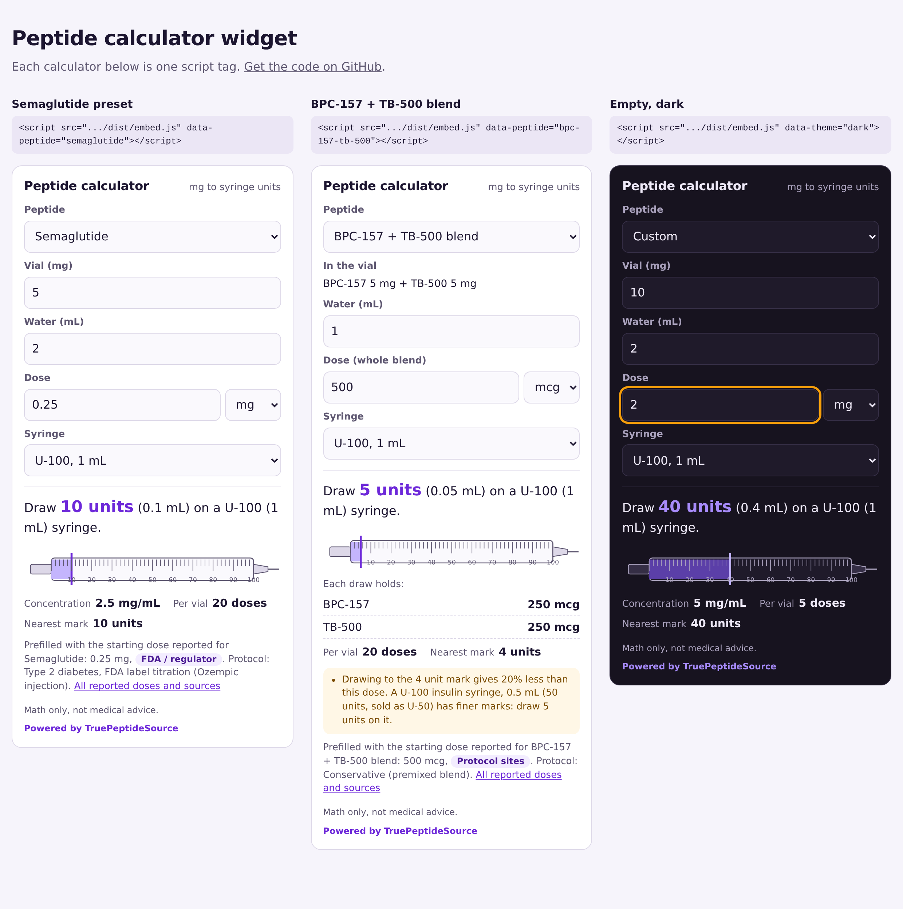

# Peptide Calculator

How many units is 2.5 mg? Free calculator for peptides and GLP-1s, on any syringe.

```html
<script src="https://cdn.jsdelivr.net/gh/TruePeptideSource/peptide-calculator@v1/dist/embed.js" data-peptide="semaglutide"></script>
```

Paste that line where the calculator should appear. That's it.

[](https://truepeptidesource.com/calculators/reconstitution)

**[Try the full calculator on truepeptidesource.com](https://truepeptidesource.com/calculators/reconstitution)** · [Demo page source](demo/index.html) (open it locally after cloning)

## The widget

- Renders right where the script tag sits, inside a Shadow DOM: your CSS can't break it, its CSS can't touch your page.
- Mobile-friendly, keyboard accessible, screen-reader results, light and dark.
- Draws the syringe with the fill line and says it plainly: "Draw 10 units (0.1 mL) on a U-100 syringe."
- Warns when a dose falls between marks, overflows the syringe or is bigger than the vial.
- About 10 KB gzipped. No tracking, no cookies, no network calls.

| Attribute | Values | Default |
|---|---|---|
| `data-peptide` | `semaglutide`, `tirzepatide`, `retatrutide`, `bpc-157`, `tb-500`, `ipamorelin`, `cjc-1295`, `ghk-cu`, `bpc-157-tb-500`, `klow`, `glow` | empty calculator |
| `data-syringe` | `U-100`, `U-50`, `U-30`, `U-40` | `U-100` |
| `data-theme` | `light`, `dark`, `auto` | `auto` (follows the visitor) |

Presets fill in the vial size, water and starting dose that truepeptidesource.com uses for that peptide, with the source label of that dose. Several widgets on one page are fine.

`@v1` follows every 1.x release. Pin `@v1.0.0` if you want it frozen.

## Use it in Claude or ChatGPT

Our MCP server gives AI assistants the same math plus every published dose range with its source label.

```
https://truepeptidesource.com/mcp
```

In Claude: **Settings > Connectors > Add custom connector**, paste the URL. Claude Code:

```sh
claude mcp add --transport http truepeptidesource https://truepeptidesource.com/mcp
```

ChatGPT, Cursor, VS Code and other clients: see [docs/mcp.md](docs/mcp.md).

## Use the library

Zero dependencies, TypeScript types included.

```sh
npm install github:TruePeptideSource/peptide-calculator#v1.0.0
```

```ts
import { reconstitute, unitsToDose, blend, blendDose, dosesPerVial } from "peptide-calculator";

reconstitute({ vialMg: 10, waterMl: 2, dose: 2, doseUnit: "mg" }).units.value;
// 40  (U-100)

reconstitute({ vialMg: 5, waterMl: 2, dose: 250, doseUnit: "mcg", syringe: "U-40" }).units.value;
// 4

unitsToDose({ vialMg: 10, waterMl: 2, units: 10 }).dose.mcg.value;
// 500

blend({ peptides: [{ name: "BPC-157", mg: 5 }, { name: "TB-500", mg: 5 }], waterMl: 2, units: 10 })
  .peptides.map((p) => `${p.name} ${p.delivered.mcg.value} mcg`);
// ["BPC-157 250 mcg", "TB-500 250 mcg"]

const KLOW = [
  { name: "GHK-Cu", mg: 50 }, { name: "BPC-157", mg: 10 }, { name: "TB-500", mg: 10 }, { name: "KPV", mg: 10 },
];
blendDose({ peptides: KLOW, waterMl: 4, dose: 2, doseUnit: "mg" }).units.value;
// 10 (whole-blend dose; pass `target: "BPC-157"` to dose one peptide instead)

dosesPerVial({ vialMg: 10, dose: 250, doseUnit: "mcg" }).fullDoses;
// 40
```

Every result is a `{ value, unit, exact }`: `value` is rounded for display (units to 0.1, mL to 0.001), `exact` is an exact fraction. The math runs on BigInt rationals, so `0.1 + 0.2` problems never reach a syringe. Bad input (zero, negative, NaN, a typo'd key) throws an `InputError` with a `code` and the field `path`.

**About syringe names.** "U-50" and "U-30" are 0.5 mL and 0.3 mL barrels printed on the U-100 scale, so they read the same units as a U-100. U-40 is a different scale: 40 units per mL.

The math is ported from truepeptidesource.com and the tests include its answers for 20 calculations, matched number for number ([test/parity.test.ts](test/parity.test.ts)).

## Open data

The **Peptide Evidence Index**: 67 peptides, their FDA status, how strong the human evidence is, and how many sources and dose protocols come from each kind of source. CSV and JSON in [data/](data/), updated 2026-11-07.

> TruePeptideSource, Peptide Evidence Index, https://truepeptidesource.com/data, CC BY 4.0

## Every number has a source

A dose without a source is a rumor. On truepeptidesource.com every dose carries one of four labels:

- **Clinical study**: from a published trial.
- **FDA / regulator**: from a drug label or regulator.
- **Protocol sites**: published on dosing guides, not verified by a study.
- **Community reported**: what people report in forums.

So you can see at a glance whether "2.5 mg" comes from a phase 3 trial or a Reddit thread. These numbers describe what studies and communities report. They are not medical advice.

## License

- Code: [MIT](LICENSE)
- Data in `data/`: [CC BY 4.0](data/LICENSE), credit "TruePeptideSource, truepeptidesource.com"

Made by [TruePeptideSource](https://truepeptidesource.com), the independent peptide reference. We don't sell peptides.
